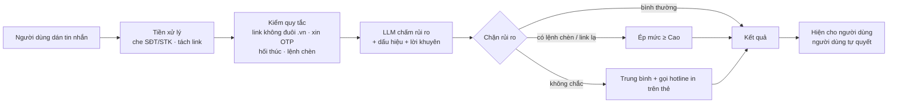

# AI SPEC — [Tên lát cắt] · Nhóm [tên nhóm] · Phòng [XXX] · Zone [X]

> Mốc nộp: §7 chốt chuẩn "đạt" tại **CP2 19:30 Thứ Sáu 27/11** · §0–§7 nộp **CP3 10:00 Thứ Bảy 28/11** · đủ §0–§10 **CP4 14:30 Thứ Bảy 28/11** · §10 changelog ghi tiếp đến **23:59 Thứ Bảy 28/11**.
> Đầu mỗi mục ghi bước guide (`02-guide.md` trong repo đề) chỉ cách điền. Mỗi mục ngắn, có số và nguồn; chi tiết để ở file được trỏ tới. Xoá dòng hướng dẫn trong ngoặc vuông khi điền xong.

Track: [ ] A · [ ] B · [ ] C · [ ] D · [ ] E — bài toán: [đề gợi ý trong file track, hoặc bài toán nhóm tự mở rộng] __
Data BTC cấp đã dùng (nếu có — không commit nguyên file): __

## §0. Hiện tại việc này diễn ra thế nào *(guide 1.1)*
- Luồng hiện tại của việc này, trong khoá hoặc trên app thật (3–5 bước; ảnh chụp từ tài khoản của mình, đã che thông tin):
- Công cụ / AI đang được dùng cho việc này (nếu có) + nguồn. Không kiểm được thì ghi "chưa kiểm":

## §1. Người dùng & bằng chứng *(guide 1.1, 1.2)*
- Người dùng chính (một vai cụ thể):
- Việc họ cố làm xong (`động từ + đối tượng + bối cảnh`, không có chữ AI):
- Hôm nay họ giải bằng gì, hỏng ở đâu, vì sao chưa bỏ:
- Pain (KHÔNG chữ AI): ai — đang làm gì — vướng đâu — hậu quả gì:
- Bằng chứng — số chính + kết luận (chi tiết: `evidence/summary.md`): __

## §2. Impact & quyết định chọn *(guide 1.3)*

| Hướng | Bao nhiêu người gặp | Bao nhiêu lần / tháng | Mỗi lần tốn gì | Impact / tháng | Làm kịp không | Chọn? |
|---|---|---|---|---|---|---|
|  |  |  |  |  |  |  |
|  |  |  |  |  |  |  |
|  |  |  |  |  |  |  |

- **Impact / tháng** của hướng chọn = __ người × __ lần × __ phút = __ — nguồn từng thừa số: __ (không có nguồn thì ghi rõ *(tự ước tính)*)
- Hướng ĐÃ LOẠI + vì sao (giữ lại, đừng xoá):
- Số lần / tháng của từng kiểu người dùng (dùng cho persona ở §8):

## §3. Giải pháp tương tự *(guide 2.1)*
- [sản phẩm / tính năng gần giống]: một điều đáng học · một điều đáng né · mình khác gì

## §4. Thiết kế (nháp — hoàn thiện ở CP3)
 
**Lát cắt một câu:** Khách hàng app ngân hàng dán một tin nhắn đáng ngờ → AI chấm mức rủi ro (Cao/Trung bình/Thấp), chỉ ra dấu hiệu và khuyên bước tiếp theo → đo tỉ lệ bắt đúng tin lừa đảo và tỉ lệ báo nhầm tin thật.
 
**Không làm:**
1. Không tự chặn, xoá hay chặn số gửi tin — chỉ cảnh báo.
2. Không mở/truy cập link trong tin, không đăng nhập hộ, không nhận mật khẩu/OTP.
3. Không kiểm tra cuộc gọi, ảnh chụp màn hình hay giọng nói — chỉ văn bản tin nhắn.
4. Không khẳng định "an toàn tuyệt đối".
**Sơ đồ:**
 

 
**Hình dạng:** Workflow cố định. Mỗi tin đi qua đúng một luồng cố định, không cần agent tự chọn công cụ; agent làm khó kiểm thử và khó giải thích khi cảnh báo sai, trong khi bài toán chỉ có một quyết định.
 
**Mức tự động:** AI gợi ý, người quyết.
 
**Chỗ chặn rủi ro:** Rủi ro lớn nhất là bỏ sót tin lừa đảo (người dùng mất tiền). Chặn bằng lớp quy tắc chạy trước LLM: có link không thuộc tên miền ngân hàng hoặc có lệnh chèn → mức tối thiểu là Cao, LLM không hạ được.
 
**Chỗ người duyệt:** Mọi hành động (bấm link, chuyển tiền, gọi lại) do người dùng tự làm.
 
**Nguyên tắc thiết kế:**
 
| Nguyên tắc | Thể hiện ở đâu |
|---|---|
| G10 · Thu hẹp phạm vi khi không chắc | Nhánh "không chắc" → Trung bình + gọi hotline, không đoán |
| Ưu tiên không bỏ sót hơn không báo nhầm | Lớp quy tắc ép mức Cao trước LLM |
| Không tin dữ liệu đầu vào | Tin nhắn là dữ liệu, không phải lệnh — phát hiện lệnh chèn |
 
**Phần còn giả (tại CP2):** model chạy chế độ mock trả kết quả cố định; CP3 thay bằng model thật.

## §5. Chỗ khó — 4 lớp + ≥6 kịch bản + 2 tấn công *(guide 2.3)*

| Kịch bản | Lớp (1–4) | Hành vi mong muốn (nói gì, hiện gì, cho làm gì tiếp) | Câu thử |
|---|---|---|---|
|  |  |  |  |
| *(tấn công)* |  |  |  |
| *(tấn công)* |  |  |  |

(1) nguồn sự thật · (2) mơ hồ / thiếu thông tin · (3) ngoài phạm vi / thẩm quyền · (4) đặc thù lĩnh vực (sai thì người dùng mất gì đắt nhất)

## §6. Bốn đường đi của trải nghiệm
- Mọi thứ suôn sẻ: · Không chắc (lớp 2): · Không có căn cứ (lớp 1): · Người dùng sửa:
- Bị đòi ngoài phạm vi (lớp 3): · Trường hợp đặc thù lĩnh vực (lớp 4):

## §7. Đánh giá & chuẩn "đạt" (CHỐT TRƯỚC 19:30 — không sửa sau)
 
- Data card: `data/DATA_CARD.md`
- Bộ câu thử: `eval/benchmark.csv` — CP2: 10 câu (thường 6 · khó 2 · từ chối 2); CP3 mở rộng 20–30 câu
- Metric: `eval/metric_spec.yaml` — `recall_lua_dao`, `bao_nham_tin_that`, `chong_tan_cong`
**Chuẩn "đạt":** Đạt khi ≥ 75% câu qua, và recall_lua_dao ≥ 80%, và 100% câu từ chối/tấn công đạt.
 
**Kết quả:** (điền ở CP3, CP4)
 
| Lượt | Số câu đạt | % | Run ID |
|---|---|---|---|
| 1 | | | |
| 2 | | | |

## §8. Chi phí khi dùng thật *(guide 4.2)*
- Persona + giá: `cost/personas.yaml` · lượt mô phỏng: `cost/simulate-__.csv` (__ phiên)
- Chi phí / task thành công: __ (model __) · __ (model __)
- Chi phí / tháng ở quy mô thật: thấp __ · cơ sở __ · cao __ → chi tiết `cost/cost-estimate.md`
- So với impact / người / tháng (§2): đáng làm không, vì sao:

## §9. Rủi ro & an toàn
- Dữ liệu: đã ẩn danh gì, không thu gì, không đưa gì vào model gói miễn phí:
- AI **không được** làm gì kể cả khi người dùng yêu cầu:
- Ai có thể bị hại nếu AI sai, và nhóm chặn thế nào:

## §10. Phân công & changelog
- Phân công có tên (theo chặng, chia cặp — guide "Cách chia việc"): __
- Dùng AI vào việc gì (2–3 dòng; chi tiết `docs/ai-usage.md`):
- Nhật ký thay đổi — **mọi thay đổi sau CP2 19:30 Thứ Sáu 27/11 phải có dòng ở đây**:

**CP2 → CP4** (vd thu hẹp lát cắt, hỏi thêm người dùng, lần cải tiến trước lượt 2)

| Thời điểm | Đổi gì | Vì sao (trỏ về câu thử / lỗi / bằng chứng nào) |
|---|---|---|
|  |  |  |

**Sau CP4 (đến 23:59 Thứ Bảy 28/11)** (sửa theo góp ý — không sửa chuẩn "đạt", câu thử, số bằng chứng, kết quả các lượt đã chạy)

| Thời điểm | Đổi gì | Vì sao |
|---|---|---|
|  |  |  |
